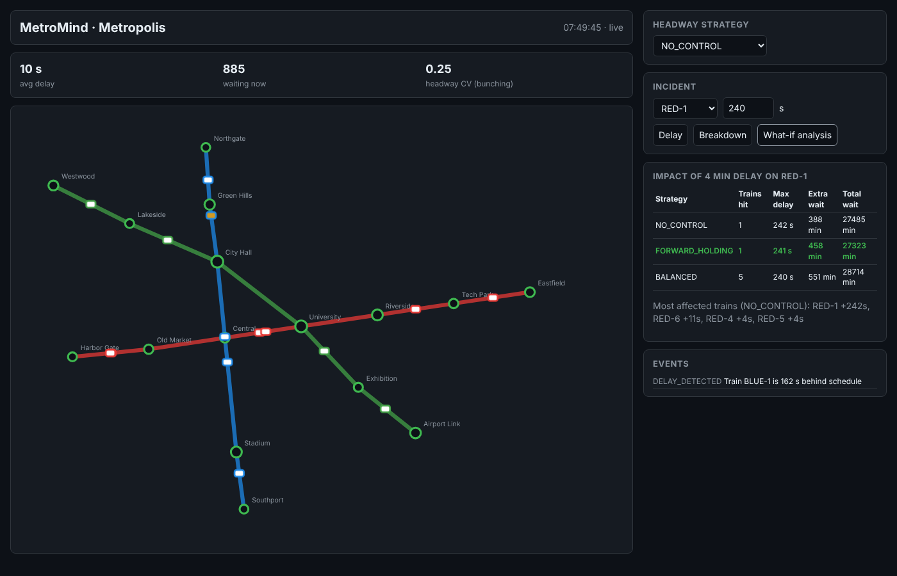

# MetroMind

**A digital twin of a city metro system.** MetroMind simulates trains, stations and passenger flows in real time,
detects delays, predicts overcrowded stations and answers the key operational question:

> *Train RED-3 is stuck for 4 minutes. What happens to every other train and station in the next 30 minutes,
> and which dispatching strategy limits the damage best?*



## What it does

| Feature | How |
|---|---|
| Virtual trains, stations, lines | Network loaded from JSON, persisted to PostGIS (`GEOGRAPHY(POINT)`, `GEOMETRY(LINESTRING)`) |
| Train movement | Discrete-time engine, 1 s step, fixed-block signalling (segment + next platform) |
| Passenger flow | Fluid demand model with morning/evening peaks; origin–destination matrix (gravity model or explicit weights); fastest-route assignment with transfers at interchanges; one queue per station, line and direction, tracked by destination; crowding-dependent dwell times |
| Delay detection | Each train tracks lateness against its nominal schedule; alerts at 120 s, recovery at 60 s |
| Overload prediction | 15-minute forecast per station, summed over its directional queues: queue + inflow (new trips and recent transfers) − share of free space of trains calling in that direction, after their passengers for this station alight |
| Dynamic headway control | Pluggable `HeadwayStrategy`: `NO_CONTROL`, `FORWARD_HOLDING`, `BALANCED` (two-way headway balancing) |
| Incidents & failures | Inject delays or breakdowns on any train at runtime |
| **Delay propagation (what-if)** | Fork the live engine, run *baseline* vs *incident* for every strategy, diff arrivals and passenger wait |

### The delay-propagation mechanic

The engine is fully deterministic, so it can be copied. `DelayPropagationAnalyzer` takes a snapshot of the live
network, makes two copies per strategy, injects the delay into one, simulates both for the horizon and reports:

- extra delay per train (how much later it reaches each stop than in the baseline);
- extra passenger-minutes of waiting per station, and peak queue growth;
- headway regularity (coefficient of variation) at the end of the horizon;
- the strategy with the lowest total passenger wait.

```http
POST /api/analysis/delay-impact?horizonSeconds=1800
{ "trainId": "RED-3", "seconds": 240 }
```

## Architecture

```
            ┌──────────────────────── Spring Boot backend ────────────────────────┐
            │  SimulationEngine ──► SimulationService (@Scheduled tick)            │
 Next.js ◄──┤        │                      │                                     │
 (STOMP/WS) │  DelayPropagationAnalyzer     ├──► WebSocket  /topic/state          │
            │  HeadwayStrategy              ├──► Kafka      metromind.train-positions, metromind.events
 REST ─────►│  REST /api/*                  ├──► Redis      metromind:snapshot, metromind:station-waiting
            │                               └──► PostGIS    station, line, incident │
            └──────────────────────────────────────────────────────────────────────┘
```

**Stack:** Java 21 · Spring Boot 3.5 · Spring Kafka · Spring Data Redis · PostgreSQL 16 + PostGIS · Flyway ·
STOMP over WebSocket · Next.js 15 / React 19 / TypeScript · Docker Compose · GitHub Actions.

## Running

Everything in Docker:

```bash
docker compose up --build
# UI: http://localhost:3000   API: http://localhost:8080/api/state
```

Backend without any infrastructure (simulation + WebSocket only):

```bash
cd backend && mvn spring-boot:run -Dspring-boot.run.profiles=standalone
cd frontend && npm install && npm run dev
```

Infra in Docker, backend from the IDE: `docker compose up -d postgres redis kafka`, then run
`MetroMindApplication` with the default profile.

## API

| Method | Path | Purpose |
|---|---|---|
| GET | `/api/network` | Stations and lines |
| GET | `/api/state` | Latest simulation snapshot |
| GET | `/api/strategies` | Available headway strategies |
| PUT | `/api/strategy` | `{ "strategy": "BALANCED" }` |
| POST | `/api/incidents/delay` | `{ "trainId": "RED-3", "seconds": 240 }` |
| POST | `/api/incidents/breakdown` | `{ "trainId": "BLUE-2", "seconds": 600 }` |
| POST | `/api/analysis/delay-impact` | What-if analysis across strategies |
| POST | `/api/simulation/pause` / `resume` | Pause or resume the clock |

WebSocket: connect to `ws://localhost:8080/ws` (STOMP) and subscribe to `/topic/state`.

Each station in a snapshot carries `queues`: waiting passengers per line and direction, e.g.
`{ "lineId": "RED", "towardsStationId": "R7", "waiting": 42.0 }`. A train only boards the queue for the
direction it is about to travel in; terminals have a single queue towards the other end of the line.

### Passenger demand and routing

Every passenger has an origin and a destination. By default destinations follow a gravity model: from any
station, a destination attracts trips in proportion to its own ridership (`baseArrivalsPerMinute`). A network
file may override this per origin with relative weights (destinations not listed get none):

```json
"odWeights": { "R1": { "R3": 3, "B6": 1 } }
```

Passengers take the fastest route: each segment costs its nominal run time plus a dwell, boarding a line costs
half its headway and a change of line adds a 120 s walk. They leave the train at their destination, or at an
interchange where they join the queue for their next line. Snapshot `metrics` report `passengersServed`
(boardings, one per line ridden), `passengersDelivered` (completed journeys) and `transfers` (line changes).

## Project layout

```
backend/   Spring Boot service (sim engine, analysis, adapters)
frontend/  Next.js dashboard
docs/      Roadmap and design notes
```

See [docs/ROADMAP.md](docs/ROADMAP.md) for what is planned next.
