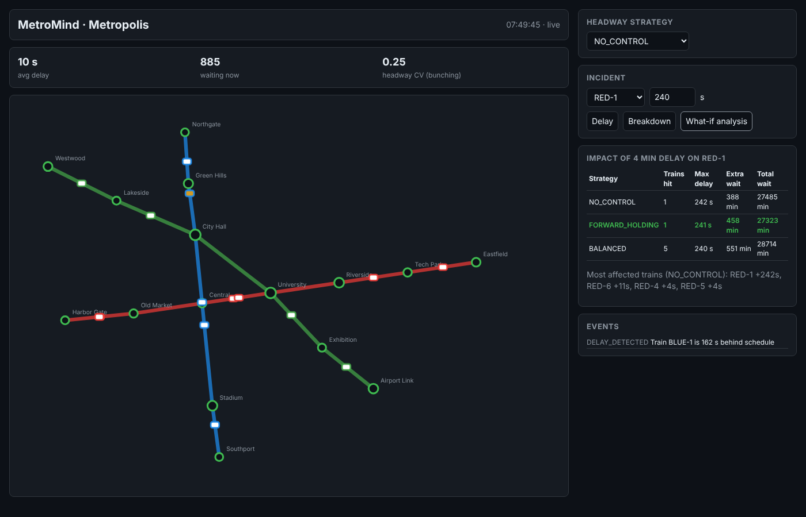

# MetroMind

**A digital twin of a city metro system.** MetroMind simulates trains, stations and passenger flows in real time,
detects delays, predicts overcrowded stations and answers the key operational question:

> *Train RED-3 is stuck for 4 minutes. What happens to every other train and station in the next 30 minutes,
> and which dispatching strategy limits the damage best?*



## What it does

| Feature | How |
|---|---|
| Virtual trains, stations, lines | Network loaded from JSON or GeoJSON (a bundled Baku network included), persisted to PostGIS (`GEOGRAPHY(POINT)`, `GEOMETRY(LINESTRING)`) |
| Train movement | Discrete-time engine, 1 s step, fixed-block signalling (segment + next platform) |
| Passenger flow | Fluid demand model with morning/evening peaks; origin–destination matrix (gravity model or explicit weights); fastest-route assignment with transfers at interchanges; one queue per station, line and direction, tracked by destination; crowding-dependent dwell times |
| Delay detection | Each train tracks lateness against its nominal schedule; alerts at 120 s, recovery at 60 s |
| Platform crowding | Optional `platformCapacity` per station: when platforms are full, new passengers queue at the entrance; passengers left behind by full trains are counted |
| Overload prediction | 15-minute forecast per station, summed over its directional queues: queue + inflow (new trips and recent transfers) − share of free space of trains calling in that direction, after their passengers for this station alight; on a branched line a train only relieves the passengers its service pattern would take |
| Dynamic headway control | Pluggable `HeadwayStrategy`: `NO_CONTROL`, `FORWARD_HOLDING`, `BALANCED` (two-way headway balancing), `ADAPTIVE_DISPATCH` (balancing plus spare trains from the depot when overload is predicted), `SHORT_TURN` (balancing plus short-turning badly late trains), `DEMAND_HOLDING` (forward holding against a demand-tracking target), `SKIP_STOP` (balancing plus late trains running through quiet stops), `SHORT_TURN_SKIP_STOP` (both recovery tools, short turns first) |
| Incidents & failures | Inject delays or breakdowns on any train at runtime; close a track section (signal failure) with trains waiting or turning back; close a station |
| **Delay propagation (what-if)** | Fork the live engine, run *baseline* vs *incident* for every strategy, diff arrivals and passenger wait |

### The delay-propagation mechanic

The engine is fully deterministic, so it can be copied. `DelayPropagationAnalyzer` takes a snapshot of the live
network, makes two copies per strategy, injects the delay into one, simulates both for the horizon and reports:

- extra delay per train (how much later it reaches each stop than in the baseline);
- extra passenger-minutes of waiting per station, and peak queue growth;
- extra passenger-minutes spent on board, and the total (wait + on board);
- headway regularity (coefficient of variation) at the end of the horizon;
- recovery time: how long until headways are back to the baseline's regularity for good (see below);
- the strategy with the lowest total passenger travel time (platform wait + time on board).

**Can a delay reduce waiting?** Platform waiting alone, yes, and that is why it is not the yardstick. When a
train is late its followers catch up and pick passengers up sooner, so people move from the platform onto
crowded trains, and passengers on the late train wait aboard instead of on a platform. On the seed network a
one-minute delay could show ~375 passenger-minutes *less* platform waiting while adding ~390 minutes on board.
Trains also used to start snapped to platforms, with uneven gaps, so a delay could accidentally even out the
headways; they now start evenly spaced. What remains under `NO_CONTROL` are small net gains (well under 1 % of
total travel time) when a delay happens to rebalance load between neighbouring trains or shifts transfers at
interchanges: real effects of an uncontrolled line, not measurement errors.

```http
POST /api/analysis/delay-impact?horizonSeconds=1800
{ "trainId": "RED-3", "seconds": 240 }
```

**Recovery time.** Both runs' headway CV is sampled every 30 s. A sample is disrupted while the incident run's
CV is more than 0.05 above the baseline's; `headwayRecoverySeconds` is the time from the incident to the first
sample after the last disrupted one, `0` if the headways were never disrupted, and `null` if they still were at
the horizon. `peakHeadwayCvExcess` is the worst bunching the incident caused. Comparing against the same
strategy's baseline means bunching that would have happened anyway is not blamed on the incident. Expect long
delays to stay unrecovered within short horizons: the timetable holds early trains at terminals but cannot make
a late train catch up, so a four-minute delay leaves a gap that only layover slack absorbs.

## Architecture

```
            ┌──────────────────────── Spring Boot backend ────────────────────────┐
            │  SimulationEngine ──► SimulationService (@Scheduled tick)            │
 Next.js ◄──┤        │                      │                                     │
 (STOMP/WS) │  DelayPropagationAnalyzer     ├──► WebSocket  /topic/state          │
            │  HeadwayStrategy              ├──► Kafka      metromind.train-positions, metromind.events,
            │                               │               metromind.network-metrics ──► TelemetryKpiConsumer
 REST ─────►│  REST /api/*                  ├──► Redis      metromind:snapshot, metromind:station-waiting,
            │                               │               metromind:replay
            │                               └──► PostGIS    station, line, line_branch, incident,
            │                                               minute_kpi, benchmark_job│
            └──────────────────────────────────────────────────────────────────────┘
```

**Stack:** Java 21 · Spring Boot 3.5 · Spring Kafka · Spring Data Redis · PostgreSQL 16 + PostGIS · Flyway ·
STOMP over WebSocket · Next.js 15 / React 19 / TypeScript · Docker Compose · GitHub Actions.

## Running

Everything in Docker:

```bash
docker compose up --build
# UI: http://localhost:3000   API: http://localhost:8080/api/state
```

Backend without any infrastructure (simulation + WebSocket only):

```bash
cd backend && mvn spring-boot:run -Dspring-boot.run.profiles=standalone
cd frontend && npm install && npm run dev
```

Infra in Docker, backend from the IDE: `docker compose up -d postgres redis kafka`, then run
`MetroMindApplication` with the default profile.

### Choosing a network

The simulated city is set by `metromind.network` (env `METROMIND_NETWORK`). Three networks are bundled: the
fictional seed city `classpath:network/metropolis.json` (default), the Baku Metro,
`classpath:network/baku.geojson`, and the fictional ring city `classpath:network/ringtown.json`. Any Spring
resource location works too (`file:/path/city.geojson`):

```bash
cd backend && mvn spring-boot:run -Dspring-boot.run.profiles=standalone \
  -Dspring-boot.run.arguments=--metromind.network=classpath:network/baku.geojson
METROMIND_NETWORK=classpath:network/baku.geojson docker compose up --build
```

**GeoJSON networks.** A file ending in `.geojson` is read as a `FeatureCollection`, the format station and track
data usually comes in (OpenStreetMap exports, open-data portals, QGIS):

| Feature | Geometry | Properties |
|---|---|---|
| Station | `Point` | `id` (or the feature's `id`), `name`, `baseArrivalsPerMinute`, optional `platformCapacity` |
| Line | `LineString`: the track, first station to last (a ring's track is closed, back to its first station) | `id`, `name`, `color`, `stationIds` (in track order), `trainCount`, `trainCapacity`, optional `spareTrains`, optional `ring`, optional `timingStationIds`, optional `fleetPlan`, and optionally `runSeconds` or `averageSpeedKmh` |
| Branch | `LineString`: the branch track, from the junction to the branch terminal | `id`, `branchOf` (the line), `junctionStationId`, `stationIds` (branch stations after the junction, in track order), `share`, and optionally `runSeconds` or `averageSpeedKmh` |
| Collection | (its own `properties`) | `city`, optional `odWeights` and `crossPlatform` as in the JSON format |

When a line gives no `runSeconds`, each is derived from the distance between its stations *along the track*
divided by the line's average start-to-stop speed (32.4 km/h unless set), so a curving section takes longer than
the straight-line distance suggests. Stations must lie within 250 m of their line's track and be listed in the
direction it is drawn; a file that breaks these rules stops startup with a message naming the station. The track
is kept on the line (`path` in `GET /api/network`): the dashboard draws it, running trains are placed along it
rather than on the chord between stations, and PostGIS stores it as the line's `LINESTRING`.

**Ring lines.** A line with `"ring": true` has no terminals: its trains run round the stations in the order
listed and carry on from the last station to the first, so `runSeconds` has one entry per station, the last for
that closing run (in GeoJSON it is derived from the closed track like the others). A ring runs one way; a ring
served in both directions is two ring lines over the same stations, one listing them in reverse, each with its own
platforms and fleet. With no terminal to lay over at, the ring's first station is its timing point, where early
trains wait for the timetable. Nothing can turn back on a ring, so short-turning strategies and `TURN_BACK`
closures leave its trains waiting instead; a closed ring station sends its passengers to the stations either side.

**Branched lines.** Some lines split: past a junction, part of the fleet runs to a branch instead of the end of
the main route. A line lists its branches under `branches`, each with the `junctionStationId` (an intermediate
station of the main route), the branch `stationIds` in order away from the junction, `runSeconds` (junction to
the first branch station, then between them), the `share` of the line's trains that run there and an optional
`path` from the junction:

```json
{ "id": "RED", "stationIds": ["R1", "R2", "R3", "R4"], "runSeconds": [100, 110, 120], "trainCount": 6, ...,
  "branches": [ { "junctionStationId": "R2", "stationIds": ["B1", "B2"], "runSeconds": [90, 80], "share": 0.33 } ] }
```

The engine runs each way through the network as a *service pattern*: the main route, and for each branch the
trunk from the first terminal to the junction followed by the branch. A branch gets its share of the trains
(rounded), the main route the rest, and each pattern keeps its own timetable. Headway control regulates what
passengers on a platform see: on the trunk the combined service of every pattern calling there (its even headway
is `1 / Σ trains / loop time` over those patterns), on a branch or beyond the junction that pattern alone, so
trains of the two patterns do not bunch on the trunk. Signalling blocks are physical track (a station's platform in one direction, or the run to the next station), so trains of
both patterns exclude each other on the shared trunk and at the junction platform where the branch merges back.
On a trunk platform everyone for a trunk station boards the first train, while passengers for the branch (or
for the far end of the main route) wait for a train going there; travelling from a branch to the far end of the
main route means changing trains at the junction. Track closures may be on the trunk, which stops both
patterns, or on a branch.

**Flat junctions.** A branch is grade-separated by default: its trains never get in the way of the main route.
Give it `"crossingSeconds"` (in JSON or as a GeoJSON branch property) to model a flat junction instead, where a
train leaving the junction for the branch crosses the opposite main track. It occupies the crossing for that many
seconds after departing; a main-route train running back into the junction stops short of the crossing meanwhile,
and one already within the crossing time of the platform goes first, so the branch train waits at the junction.
Trains merging back from the branch join their own track and do not cross anything. The station drawer of a
junction says when it is flat.

**Trunk regularity.** The overall headway CV judges each pattern on its own, so two trains of different patterns
running as a pair on the trunk look perfectly regular. The engine therefore also logs the last 8 departures, of
any pattern, from the trunk's last station (the junction) in each direction and reports the coefficient of
variation of their gaps, averaged over both directions, per branched line: `metrics.trunkHeadwayCv` in the
snapshot (`{"M1": 0.11}`; unbranched lines have no entry, and a line reads 0 until its trains have left the
junction three times), `trunkHeadwayCvAtHorizon` in each what-if outcome, `meanTrunkHeadwayCv` (mean over the
scenarios) in each benchmark ranking, and the `metromind.headway.trunk.cv` gauge. The dashboard shows it next to
the headway CV, and the what-if and benchmark tables add a "Trunk CV" column when the network has a branch.

Under `ADAPTIVE_DISPATCH` a spare train from the depot runs the pattern whose
passengers (those its trains would board) have the worst forecast, the main route on a tie. The dashboard draws each branch in
its line's colour from the junction (along its `path` when given) and offers branch sections for closures;
PostGIS keeps each branch's track in `line_branch`.

The bundled Ringtown network is a small fictional city built this way: two diameters crossing at Cathedral
Square and an eight-station ring, run in both directions, that they meet at its four gates.

The bundled Baku network has the Red, Green and Purple lines with 25 stations at approximate real locations and
interchanges at 28 May and Memar Əcəmi; two of the Red line's ten trains branch off at Nəriman Nərimanov to
Bakmil; its track is simplified to straight runs between stations, and demand
and fleet sizes are illustrative.

### Tests

```bash
cd backend && mvn verify            # unit + API tests, then integration tests (needs Docker)
cd backend && mvn verify -DskipITs  # without Docker
cd frontend && npm test             # component tests (Vitest + Testing Library, jsdom)
cd frontend && npm run test:e2e     # browser smoke test (Playwright; package the backend and build first)
```

Frontend component tests sit next to the components (`*.test.tsx`) and run against a mocked `api`, with shared
network and snapshot fixtures in `frontend/test/`. They cover the KPI charts, the station and train drawer, the
map's projection and selection, and the benchmark page's submit, poll, cancel, ranking and CSV export flow.

The browser smoke test (`frontend/e2e/`) runs the production build of the dashboard in Chromium against the
backend jar on the `standalone` profile, both started by Playwright: it checks that the map draws every line and
branch, that trains arrive over the live WebSocket feed, and that clicking a station opens its drawer with a
departure board. Run `mvn -B -DskipTests package` in `backend/` and `npm run build` in `frontend/` first; servers
already listening on ports 8080 and 3000 are reused outside CI. CI runs it as its own job and keeps the Playwright
traces of a failed run.

Unit and API tests run on the `standalone` profile with no infrastructure. The `*IT` classes in
`backend/src/test/java/com/metromind/it` start the application against the same images as `docker-compose.yml`
(PostGIS, Redis, Kafka) via Testcontainers and check the adapters for real: Flyway migrations, incident and
what-if history in JSONB, the KPI upsert, PostGIS station search against the haversine reference, the Redis
snapshot cache and replay window, and telemetry flowing through Kafka into stored per-minute KPIs. The containers
are started once and shared by every integration test.

## API

| Method | Path | Purpose |
|---|---|---|
| GET | `/api/network` | Stations and lines, each line with its service `patterns` (stations, run times, trains) |
| GET | `/api/state` | Latest simulation snapshot; each train names the `patternId` it follows and the `towardsStationId` it is bound for |
| GET | `/api/stations/{id}/departures?horizonSeconds=1800` | Departure board: planned vs expected departures |
| GET | `/api/stations/nearest?lat=40.375&lon=49.82&limit=3` | Stations closest to a point, nearest first |
| GET | `/api/stations/within?lat=40.375&lon=49.82&radiusMeters=1500` | Stations within a radius, nearest first |
| GET | `/api/strategies` | Available headway strategies |
| PUT | `/api/strategy` | `{ "strategy": "BALANCED" }` |
| POST | `/api/incidents/delay` | `{ "trainId": "RED-3", "seconds": 240 }` |
| POST | `/api/incidents/breakdown` | `{ "trainId": "BLUE-2", "seconds": 600 }` |
| POST | `/api/incidents/section-closure` | `{ "lineId": "RED", "fromStationId": "R4", "toStationId": "R5", "seconds": 900, "response": "TURN_BACK" }` |
| POST | `/api/incidents/station-closure` | `{ "stationId": "R3", "seconds": 1200 }` |
| POST | `/api/analysis/delay-impact` | What-if analysis across strategies |
| POST | `/api/analysis/section-closure-impact` | What-if for a track-section closure (same body as `/api/incidents/section-closure`) |
| POST | `/api/analysis/station-closure-impact` | What-if for a station closure (same body as `/api/incidents/station-closure`) |
| POST | `/api/analysis/benchmark?scenarios=10&seed=1&horizonSeconds=1800&kinds=DELAY,STATION_CLOSURE` | Rank strategies over random incident scenarios |
| POST | `/api/analysis/benchmark/jobs` | Same benchmark as a background job: `202 Accepted`, poll `Location` |
| GET | `/api/analysis/benchmark/jobs/{id}` | Job status, progress and, once done, its report |
| DELETE | `/api/analysis/benchmark/jobs/{id}` | Cancel a queued or running job (`409` if it had already finished) |
| GET | `/api/incidents?limit=50` | Incident history, newest first |
| GET | `/api/incidents/analyses?limit=10` | Past what-if analyses with their full reports, newest first |
| GET | `/api/kpis?limit=60` | Per-minute KPIs aggregated from telemetry, oldest first |
| GET | `/api/kpis/status` | KPI aggregation watermark per telemetry topic, open minutes, late samples |
| GET | `/api/replay/range` | Span of simulated time that can be replayed (`204` before the first snapshot) |
| GET | `/api/replay?at=29000` | Snapshot as it was at a past simulated time |
| POST | `/api/simulation/pause` / `resume` | Pause or resume the clock |

The full OpenAPI 3.1 description is served at `http://localhost:8080/api-docs` (append `.yaml` for YAML) and can be
browsed in Swagger UI at `http://localhost:8080/swagger-ui.html`, grouped by area: simulation, network, incidents,
analysis, KPIs and replay.

WebSocket: connect to `ws://localhost:8080/ws` (STOMP) and subscribe to `/topic/state`.

Each station in a snapshot carries `queues`: waiting passengers per line and direction, e.g.
`{ "lineId": "RED", "towardsStationId": "R7", "waiting": 42.0 }`. A train only boards the queue for the
direction it is about to travel in; terminals have a single queue towards the other end of the line. A ring
station has a single queue too, signed towards the next station round the ring.

### Passenger demand and routing

Every passenger has an origin and a destination. By default destinations follow a gravity model: from any
station, a destination attracts trips in proportion to its own ridership (`baseArrivalsPerMinute`). A network
file may override this per origin with relative weights (destinations not listed get none):

```json
"odWeights": { "R1": { "R3": 3, "B6": 1 } }
```

Passengers take the fastest route: each segment costs its nominal run time plus a dwell, boarding a line costs
half its headway and a change of line adds a 120 s walk. They leave the train at their destination, or at an
interchange where they join the queue for their next line. Snapshot `metrics` report `passengersServed`
(boardings, one per line ridden), `passengersDelivered` (completed journeys) and `transfers` (line changes).

Some changes need no walk: the two directions of a ring, or two lines sharing an island platform, face each other
across the platform. List them as cross-platform interchanges, at given stations or (with `stationIds` left out)
wherever the lines meet; changing between them then costs only the wait for the next train:

```json
"crossPlatform": [ { "lineIds": ["RING-CW", "RING-CCW"] }, { "lineIds": ["NS", "EW"], "stationIds": ["C0"] } ]
```

A GeoJSON network puts the same list in the collection's `properties`. Ringtown's ring directions are listed this
way, so a passenger carried past a skipped ring stop steps across to the other direction to ride back.

### Timetable and departure boards

Trains start evenly spaced around each line's loop, and that start defines their timetable: planned arrivals
advance by the nominal run time plus a 25 s dwell. Delay alerts compare each arrival with this timetable. A train
that reaches a terminal early (short dwells off-peak) waits there for its planned departure, so earliness does not
carry into the next trip; late trains leave as soon as they can.

Terminals (and a ring's first station) are the default timing points. A line can name its own with
`timingStationIds` (in the JSON or GeoJSON line), for example a busy interchange half-way along a long line so
early trains are evened out before the crowds; the list then replaces the default, and trains hold there in both
directions:

```json
{ "id": "RED", "stationIds": ["R1", "R2", "R3", "R4", "R5"], "timingStationIds": ["R3"], ... }
```

`GET /api/stations/R3/departures` lists the trains leaving a station within the horizon, soonest first:

```json
{ "trainId": "BLUE-2", "lineId": "BLUE", "towardsStationId": "B6", "plannedTime": 29130.0,
  "plannedClock": "08:05:30", "expectedTime": 29372.0, "delaySeconds": 242.0 }
```

The expected time is estimated from the train's position, nominal run times and any blockage, so a negative
`delaySeconds` means the train is running early.

### Platform capacity and crowding

A station may declare how many passengers its platforms hold, all queues together:

```json
{ "id": "R3", "name": "Central", "lat": 40.375, "lon": 49.82, "baseArrivalsPerMinute": 12, "platformCapacity": 450 }
```

While the platforms are full, new passengers wait at the entrance and are let in as trains clear the queues.
Passengers changing lines are always let through, so an interchange can briefly exceed its limit. Time at the
entrance counts as waiting (it is included in delay-impact analysis), and the overload forecast adds the
entrance queue on top of the platform forecast. Stations without the field have unlimited platforms.

Snapshots report per station `heldAtEntrance` and `leftBehind` (passengers who could not board a full train in
their direction, counted once per train missed), and network-wide `passengersHeldAtEntrance` and
`passengersLeftBehind`.

### Track section closures

A signal or track failure closes the track between two adjacent stations of a line, in both directions, for a
given time. A train already inside the section finishes its run; no other train may enter it. The `response`
decides what trains do on reaching the closure:

- `WAIT` (default): the train stays at the platform before the section with a red signal. Trains behind it queue
  up station by station, as fixed-block signalling would make them.
- `TURN_BACK`: the train reverses at the last open station and serves the rest of the line in the other
  direction. Everyone still on board gets off there and waits on the platform for the line to reopen, and nobody
  boards a train that is about to turn. A train cannot turn at a terminal, or while the opposite platform is
  occupied; it waits until it can.

Snapshots list active closures under `closedSections`, with the time left before each section reopens. The
departure board and the overload forecast do not yet account for closures.

### Station closures

A closed station keeps its doors shut: trains run through it without stopping or being held (a closed terminal
still turns trains round). Its departure board is empty and its station view has `closed: true`.

- Passengers on the platforms or at the entrance when it closes walk to the neighbouring stations (adjacent on
  any line, split evenly) and queue at their entrances. New passengers arriving while it is closed do the same.
  In the fluid model they then travel like the neighbour's own passengers.
- Passengers on board who were heading for the closed station get off at the first open station after it and
  count as delivered there.
- Passengers who planned to change lines at a closed interchange stay aboard to the next open station and are
  re-routed from there using the normal route table, which may still take them through the closed station.

### What-if for closures

Closures can be analysed before they are applied, like delays. `POST /api/analysis/section-closure-impact` and
`POST /api/analysis/station-closure-impact` take the same bodies as the incident endpoints (and an optional
`horizonSeconds`, default 1800), run every strategy with and without the closure from a copy of the live state
and return the same per-strategy outcomes as the delay analysis, under the incident that was simulated:

```json
{ "incident": { "kind": "STATION_CLOSURE", "stationId": "R3", "seconds": 1200 },
  "horizonSeconds": 1800, "bestStrategy": "BALANCED", "outcomes": [ ... ] }
```

An unknown station or a pair of stations that are not adjacent is a `400`. The dashboard's closure panel has a
What-if button next to each closure. Closure analyses are not yet kept in the incident history.

### Adaptive dispatching

A line may keep spare trains in a depot next to its first terminal:

```json
{ "id": "RED", "trainCount": 6, "spareTrains": 2, "trainCapacity": 900 }
```

Under the `ADAPTIVE_DISPATCH` strategy the engine reviews every line once a simulated minute. It forecasts the
line's own platform queues 15 minutes ahead (closed stations left out); when the worst station reaches the high
overload level (400 passengers), one spare train enters service at the first terminal as soon as its platform
and the track into it are clear. It gets its own timetable from that moment, and the strategy's two-way
balancing holds spread it out among the others. When the forecast drops below the medium level (200) and the
line runs more trains than it should (its `trainCount`, or its fleet plan's count below), a train standing at the
first terminal returns to the depot;
anyone who already boarded it waits for the next one. Target headways follow the number of trains in service.
Dispatches and withdrawals appear as `TRAIN_DISPATCHED` and `TRAIN_WITHDRAWN` events, and snapshot `metrics`
report `trainsInService` and `trainsInDepot`. Other strategies leave the spares in the depot.

### Time-of-day fleet plan

Real metros run fewer trains off-peak. A line may give a `fleetPlan`, periods in order of their start, each
setting how many trains run from that time of day until the next period (the last one runs on past midnight, and
the plan repeats every day):

```json
{ "id": "RED", "trainCount": 10, "spareTrains": 2, "trainCapacity": 1000,
  "fleetPlan": [ { "from": "06:00", "trains": 6 }, { "from": "07:00", "trains": 10 },
                 { "from": "10:00", "trains": 7 }, { "from": "16:30", "trains": 10 },
                 { "from": "20:00", "trains": 6 }, { "from": "23:00", "trains": 4 } ] }
```

`trainCount` stays the fleet placed on the line when a run starts (set it to the plan's count for the start
time); the depot holds the trains the busiest period needs on top of that, plus the `spareTrains`. These are
scheduled runs, made under every strategy: at each one-minute review a line short of its plan brings one train
out at the first terminal, to the service pattern furthest below its share of the planned fleet, with its own
timetable from then on; a line over its plan sends surplus trains back to the depot as they call at the first
terminal (never a pattern's last train), so even a long line reaches its off-peak fleet within one round trip.
Under `ADAPTIVE_DISPATCH` the strategy's own spares come on top of the plan, and surplus trains only go back
once the line's forecast drops below the medium level, so a plan cut never fights an overload. Every period must
leave at least one train per service pattern. GeoJSON lines take the same `fleetPlan` property, the bundled Baku
lines have one (full peaks, a thinner midday and evening, a late-night service), `GET /api/network` lists it,
and the dashboard's line legend shows running against planned trains, in amber while a line is short.

### Short-turning for recovery

Under the `SHORT_TURN` strategy a train that is at least 4 minutes behind its timetable reverses at the
intermediate platform where it is ready to leave, instead of carrying its lateness out to the terminal and back,
provided the train behind it is closer than half the target headway (so the stations it gives up are served
again soon), the station is open and the opposite platform and the track into it are free. Everyone aboard
steps off to wait for that follower, and the train takes over the timetable slot of the opposite platform, so it
starts its return on time. Each reversal appears as a `TRAIN_SHORT_TURNED` event. On the test line, a train held
for 7 minutes is short-turned once, and 30 minutes later the line's worst lateness is about half of what
balanced holding alone leaves.

The engine logs every short turn (train, line, station, time, lateness; the last 1000 are kept). Each what-if
outcome lists the turns its strategy made during the incident run under `shortTurns`, and each benchmark
ranking reports `meanShortTurns` per scenario and `shortTurnsByStation`, the count at each station over all
scenarios, most first:

```json
{ "strategy": "SHORT_TURN", "meanShortTurns": 0.5, "shortTurnsByStation": { "R4": 2, "R5": 1 } }
```

The dashboard's what-if table shows the count and stations per strategy.

On a branched line the follower that counts is the train that will serve the stations given up. Heading for the
first terminal on the shared trunk those are all trunk stations, served by every pattern, so the next train of
any pattern calling at the platform counts; anywhere else, including on the trunk heading out, the train would
give up the far end of its own route, so only a follower of its own pattern does.

### Skip-stop for recovery

Under the `SKIP_STOP` strategy a train that is at least 2 minutes behind its timetable may run through an
intermediate stop without opening its doors, saving the dwell. It only does so when the stop is quiet (fewer
than 40 passengers would board or alight), the station is not an interchange (skipping it would strand
transfers), the train is lagging between its neighbours (the gap to the train behind is under 80 % of the gap
ahead, so the follower serves the platform soon) and it did not skip its previous stop. Lateness alone is not
enough: in a busy peak every train runs a little late. Passengers on board for the skipped station ride on to
the next stop and queue there for a train back; they are reported as `passengersCarriedPast` in the snapshot
`metrics`, not as transfers, next to `stopsSkipped`. Each skip appears as a `TRAIN_SKIPPED_STOP` event. On the
test line with a quiet stop, a train delayed by 4 minutes in the morning peak skips that stop and the line ends
the half hour with lower worst and average lateness than balanced holding alone. On a branched line's trunk the
neighbours are the trains of every pattern calling at the platform, since the passengers left behind board the
next one whatever its pattern: a branch train that only lags behind its own pattern's leader keeps calling.

The engine logs every skipped stop (train, line, station, time, lateness and the passengers carried past; the
last 1000 are kept). Each what-if outcome lists the skips its strategy made during the incident run under
`skippedStops`, and each benchmark ranking reports `meanStopsSkipped` and `meanPassengersCarriedPast` per
scenario and `stopsSkippedByStation`, the count at each station over all scenarios, most first:

```json
{ "strategy": "SKIP_STOP", "meanStopsSkipped": 1.5, "meanPassengersCarriedPast": 42.0,
  "stopsSkippedByStation": { "B3": 4, "B6": 2 } }
```

The dashboard's what-if table shows the count and passengers carried past per strategy.

### Short-turning and skip-stop combined

`SHORT_TURN_SKIP_STOP` balances headways and uses both recovery tools. A train 2 to 4 minutes late may skip
quiet stops under the skip-stop rules. A train 4 or more minutes late, late enough to be short-turned, never
skips: it calls at every stop so it can reverse as soon as a follower closes up behind it, because a short turn
wins back a whole trip's lateness at once while a skip only saves one dwell. On the test line with a quiet stop,
a train delayed by 7 minutes is turned back where `SHORT_TURN` would turn it instead of running through the
quiet stop, and a train delayed by 3 minutes skips exactly as under `SKIP_STOP`.

### Demand-tracking headway target

Every strategy receives a target headway; by default it is the line's even headway (loop time divided by trains
in service). A strategy can override `targetHeadway(evenHeadway, forecastDemandMultiplier)`, where the engine
passes the time-of-day demand multiplier forecast 5 minutes ahead. `DEMAND_HOLDING` uses forward holding and
keeps the even headway as its target off-peak (multiplier up to 0.8), then shrinks it with the square root of
demand, to no less than 60 % of the even headway. In a peak every second a train is held delays a full train
and lets platforms fill, so it trades some regularity for keeping trains moving. At night it behaves exactly
like `FORWARD_HOLDING`; around the morning peak on the test line it cuts passengers' time on board after a
delay compared with `FORWARD_HOLDING`.

### Strategy benchmark

One what-if run answers "which strategy handles *this* incident best"; the benchmark answers "which strategy
copes best in general". `POST /api/analysis/benchmark` draws `scenarios` random incidents from `seed` (a train of
the current fleet delayed for 1–10 minutes or broken down for 5–20 minutes, the track between two adjacent
stations closed for 5–20 minutes with trains waiting or turning back, or a station closed for 5–20 minutes), runs
every strategy against every scenario from the same copy of the live state for `horizonSeconds`, and measures
the mean platform wait per
boarding in each run. Strategies are ranked by the mean of that over the scenarios, then by its 95th percentile
(the bad day), then by name:

```json
{ "rank": 1, "strategy": "NO_CONTROL", "meanWaitSeconds": 336.7, "p95WaitSeconds": 535.7,
  "meanTravelMinutes": 26480.0, "p95TravelMinutes": 27310.5, "meanRecoverySeconds": 1260.0,
  "unrecoveredScenarios": 1,
  "waitSecondsPerScenario": [263.4, 218.1, 329.6, 535.7] }
```

`meanRecoverySeconds` averages the headway recovery time (as in the what-if analysis) over the scenarios the
strategy recovered from within the horizon, and `unrecoveredScenarios` counts the rest; recovery is reported
alongside the ranking and does not change it. On a network with branches `meanTrunkHeadwayCv` gives each branched
line's trunk regularity at the horizon, averaged over the scenarios (see *Trunk regularity*); the CSV export adds a
`trunk_cv_<line>` column for each.

Wait per boarding only sees time on platforms, so a strategy that holds trains longer or carries passengers past
skipped stops can look better than it is. `?metric=TRAVEL_TIME` ranks by `meanTravelMinutes` instead (total
passenger time over the horizon, platform wait plus time on board), then by its 95th percentile
`p95TravelMinutes`, then by name. The report names the metric it was ranked by (`"metric": "TRAVEL_TIME"`); the
default is `WAIT_PER_BOARDING`, and the figures for each strategy are the same under both.

Each scenario lists only what its kind needs:

```json
{ "kind": "SECTION_CLOSURE", "lineId": "RED", "fromStationId": "R4", "toStationId": "R5",
  "response": "TURN_BACK", "seconds": 840.0 }
```

`kinds` narrows the draw, e.g. `?kinds=SECTION_CLOSURE,STATION_CLOSURE` to compare strategies on closures only;
by default all four kinds are drawn. The same seed, kinds and starting state always give the same report, and
the live simulation is never touched. Limits: 1–50 scenarios, a horizon of 5–60 minutes.

**Large runs as background jobs.** `POST /api/analysis/benchmark/jobs` takes the same parameters, copies the live
state at once and answers `202 Accepted` with the queued job and its URL in `Location`. Poll
`GET /api/analysis/benchmark/jobs/{id}` until `status` is `SUCCEEDED` (the job then carries the `report`) or
`FAILED` (with an `error`):

```json
{ "id": "6f1c…", "status": "RUNNING", "completedRuns": 37, "totalRuns": 99, "progress": 0.37,
  "submittedAt": "2026-11-16T08:00:00Z", "startedAt": "2026-11-16T08:00:00Z", "finishedAt": null,
  "report": null, "error": null }
```

A run is one strategy simulated once (a baseline, then each scenario), so a job makes
`strategies × (scenarios + 1)` runs. Jobs run one at a time and allow up to 200 scenarios and a two-hour horizon.
The 20 most recent jobs are kept (`GET /api/analysis/benchmark/jobs` lists them); while all 20 are still queued
or running a new submission gets `429 Too Many Requests`.

`DELETE /api/analysis/benchmark/jobs/{id}` cancels a job and answers with it as `CANCELLED`. A queued job never
starts; a running one stops once the simulated run in progress ends, keeping its `completedRuns` but no report, and
the next queued job starts. A job that had already succeeded or failed is left alone and returned with
`409 Conflict`.

With persistence enabled, every job that succeeds, fails or is cancelled is also written to the `benchmark_job`
table (the report as JSONB). Lookups and the job list fall back to it, so finished jobs and their reports stay
available after they drop out of the 20 kept in memory and after a restart. Jobs still queued or running when the
backend stops are lost. In the `standalone` profile jobs live in memory only.

The dashboard's benchmark page (`/benchmark`) runs these jobs and shows their ranking; **Export CSV** saves the
ranking with one row per strategy in rank order and raw numbers (`mean_wait_s`, `p95_wait_s`, `mean_travel_min`,
`p95_travel_min`, `mean_recovery_s`, empty when the strategy never recovered, `unrecovered_scenarios`,
`mean_short_turns`, `mean_stops_skipped`, `mean_passengers_carried_past`), named after the seed and ranking metric,
for comparing runs in a spreadsheet.

### Incident clearing timeline

Every incident clears on its own: a delayed or broken-down train moves again when its stoppage runs out, and a
closed section or station reopens when its time is up. Snapshots list what is still in force under
`activeIncidents`, soonest to clear first:

```json
{ "kind": "SECTION_CLOSURE", "subjectId": "RED", "description": "Track University–Riverside on line RED closed",
  "startedAt": 28800.0, "clearsAt": 29700.0, "remainingSeconds": 412.0 }
```

`kind` is `TRAIN_DELAY`, `BREAKDOWN`, `SECTION_CLOSURE` or `STATION_CLOSURE`. A second incident on a stopped train
extends the stoppage and keeps its start; a breakdown on a delayed train turns it into a breakdown. Extending a
closure keeps its start too. The dashboard draws these as a timeline: elapsed time faded, remaining time solid,
with a countdown to each clearing.

### Incident history

Every incident injected through the API (delay, breakdown, track or station closure) is recorded with the
simulation time, its subject (train, line or station), its duration and, for track closures, the section and
how trains react (`"detail": "R4-R5, TURN_BACK"`). Each delay what-if analysis is recorded too, with its full report.
With persistence enabled they are stored in PostgreSQL (`incident` and `incident_analysis`, the report as
JSONB) and survive restarts; in the `standalone` profile the last 500 incidents and 50 analyses are kept in
memory.

### Per-minute KPIs

`TelemetryKpiConsumer` (consumer group `metromind-kpi`) reads the three telemetry topics and folds them into one
row per minute of simulated time: trains reporting, mean and worst lateness, mean load factor, mean and peak
passengers waiting, mean headway CV, delay alerts raised and incidents started. It only depends on the topics, so
it can run in an instance of its own. Kafka spreads trains over partitions, so messages arrive slightly out of
order, and each topic has its own listener, so one topic can fall minutes behind another. The aggregator keeps a
watermark per topic: a minute stays open until both per-tick topics (positions and network metrics) are 30 s past
its end, so a backlog on positions holds minutes open instead of losing their samples. Events are sparse and never
hold a minute open. Anything that still arrives after its minute closed is dropped (and counted); if a topic stalls,
at most 60 minutes are kept open and the oldest is closed first. Closed minutes go to the `minute_kpi` table;
re-aggregating a minute overwrites it. Without Kafka (`standalone`) the simulator feeds the same aggregator directly
and the last 24 hours are kept in memory.

`GET /api/kpis/status` shows how far aggregation has got, which makes a lagging topic easy to spot:

```json
{ "watermarks": { "POSITIONS": 29105.0, "METRICS": 29240.0, "EVENTS": 28870.0 }, "openMinutes": 3, "lateSamples": 0 }
```

```json
GET /api/kpis?limit=1
[{ "minute": 485, "clock": "08:05", "trainsReporting": 18, "averageDelaySeconds": 12.4, "maxDelaySeconds": 96.0,
   "averageLoadFactor": 0.41, "averageWaiting": 1310.5, "maxWaiting": 1342.0, "averageHeadwayCv": 0.08,
   "delayAlerts": 0, "incidents": 0 }]
```

The dashboard charts the last hour of these minutes, refreshed every 6 s: average and worst train delay, and
average and peak passengers waiting network-wide. Hover a column to read every value for that minute.

The map's legend lists every line in its colour. A ring line is marked ↻ or ↺ for the way its trains turn on the
north-up map, and arrows along its track point the way they run, so the two directions of a ring sharing one
track (Ringtown's) can be told apart.

Click a station or train on the map (or focus it with Tab and press Enter) to open a detail drawer. A station
shows its lines, passengers waiting now and predicted in 15 minutes with the overload risk, the queue on each
platform and its live departure board with lateness. A train shows where it is heading, where it is, what it is
doing (running, dwelling, held, waiting at a signal), its lateness and load, and any incident and recent events
concerning it.

On a branched line, a train bound for the branch terminal carries a label on the map ("to Bakmil") until it turns
back; every train's tooltip names its destination (on a ring, the next station, as on the platform signs), and
departure board rows bound for a branch terminal are marked as such. While a train's drawer is open, the map rings the stations
its service pattern calls at in the line colour and fades the other stations and lines, so a Bakmil train shows
the trunk and the branch it serves rather than the whole Red line.

A what-if result is also drawn on the map: each station is ringed by the extra passenger-minutes of waiting the
incident causes under the best strategy, red where waiting grows and blue where it falls, scaled to the worst
station. Click another row of the what-if table to map that strategy instead, or hide the layer.

The **Benchmark** page (`/benchmark`, linked from the dashboard header) runs the strategy benchmark as a
background job: pick the number of scenarios, the seed, the horizon, the incident kinds and the ranking metric,
watch the progress bar (or cancel the run from it), then read the ranking and the scenarios that were drawn.
Earlier jobs still kept by the backend are listed and can be reopened.

### Spatial station search

`/api/stations/nearest` and `/api/stations/within` answer "which station is closest to me" and "which stations
are within walking distance". With persistence enabled they run in PostGIS on the `station.location` geography
column: a KNN search (`ORDER BY location <-> point`) and `ST_DWithin`, both served by its GiST index, with
distances on the WGS84 spheroid. In `standalone` the same queries use great-circle (haversine) distance, within
about 0.5 % over a city. Each result is `{ "station": { "id": "R3", "name": "Central", ... }, "distanceMeters": 14.2 }`;
ties are ordered by station id.

### Replay and time travel

The last `metromind.replay.retention-minutes` (30) of simulated time are kept as full snapshots, one every
`metromind.replay.interval-seconds` (10) of simulated time; a paused clock stores nothing new. With Redis they
live in the sorted set `metromind:replay`, scored by simulated time, so other services can replay them too; in
`standalone` they stay in memory. A restarted simulator starts a new timeline and clears the set.

`GET /api/replay/range` returns `{ "fromSimTime": 27000, "toSimTime": 28800, "snapshots": 181 }`, and
`GET /api/replay?at=27950` returns the newest kept snapshot taken at or before that time, in the same shape as
`/api/state` (`404` if it is older than the range).

### Operational metrics

The backend publishes Micrometer meters at `/actuator/metrics` and in Prometheus format at `/actuator/prometheus`:

| Meter | Type | What it measures |
|---|---|---|
| `metromind.sim.tick` | timer (p50, p95, p99) | Wall-clock time to advance the live engine by one tick and snapshot it |
| `metromind.analysis.duration` | timer, tag `kind` | Wall-clock time of what-if work: `delay`, `section_closure`, `station_closure`, `benchmark` |
| `metromind.incidents.injected` | counter, tag `kind` | Incidents injected into the live simulation |
| `metromind.sim.time` | gauge | Simulated seconds since midnight |
| `metromind.passengers.waiting` | gauge | Passengers waiting at all stations |
| `metromind.trains.delay.average`, `.max` | gauges | Lateness of trains in service, in seconds |
| `metromind.trains.in.service` | gauge | Trains running on the lines |
| `metromind.headway.cv` | gauge | Headway coefficient of variation (0 is perfectly regular) |
| `metromind.headway.trunk.cv` | gauge, tag `line` | Headway CV of a branched line's patterns together on their shared trunk |

Gauges read the latest published snapshot, so a scrape never waits for the engine lock. A tick that takes longer
than `metromind.sim.tick-millis` means the simulation is falling behind its configured speed.

## Project layout

```
backend/   Spring Boot service (sim engine, analysis, adapters)
frontend/  Next.js dashboard
docs/      Roadmap and design notes
```

See [docs/ROADMAP.md](docs/ROADMAP.md) for what is planned next.
